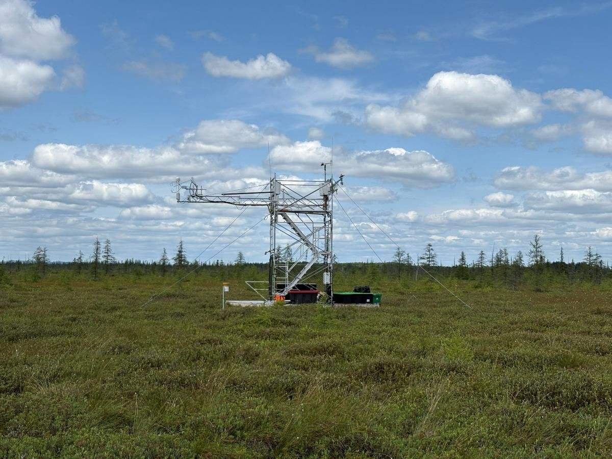

# David Ulises Trejo Cancino · Portfolio

**Live site: https://davidulicio.github.io/portfolio/**

Personal portfolio of David Ulises Trejo Cancino, an environmental monitoring and eddy covariance specialist based in Montreal, Quebec, Canada. It covers my work building and running flux towers, weather stations and off-grid power systems in Canada and Chile, along with the software I write for field work and my academic contributions.

The site is available in **English, Spanish and French**.



## What's on the site

- **About:** background, skills and languages.
- **Experience:** every role, newest first. Each card expands to show details, photos and tags.
- **Installations:** towers and stations on an interactive map, with filters by type. Each installation has its own page with equipment, photos and videos, and a shareable link (for example `#installation/uqam-3-forested-bog-2025`).
- **Updates:** field news, posts and press coverage.
- **Projects:** featured software, plus a list of my other public GitHub repositories that updates automatically.
- **Academic contributions:** peer-reviewed articles, datasets and conference talks and posters, with DOIs.

## How it's built

It's a static site with no build step and no framework:

- plain **HTML, CSS and JavaScript** (ES modules)
- content stored as **JSON** files in `content/`, rendered in the browser
- **[Leaflet](https://leafletjs.com/)** for the map, bundled in `assets/vendor/`, with **OpenStreetMap** tiles
- an earthy light theme with an automatic **dark mode**
- a responsive layout, lazy-loaded images and reduced motion for visitors who ask for it
- structured data (schema.org `Person`) so search engines and AI tools can read the profile
- hosted on **GitHub Pages**, with content edited through **[Pages CMS](https://pagescms.org)** (configured in `.pages.yml`)

```
index.html                  page skeleton
assets/css/styles.css       styles and theme
assets/js/app.js            rendering, map, lightbox, language switch
assets/js/i18n.js           interface text in EN / ES / FR
assets/vendor/leaflet/      map library
content/*.json              site content (profile, experience, installations, updates, academic, projects)
media/                      photos, videos and documents
.pages.yml                  editing forms for Pages CMS
```

## Run it locally

The browser won't load the JSON files from `file://`, so serve the folder over HTTP:

```bash
python3 -m http.server 8000
# then open http://localhost:8000
```

## Updating content

All content lives in `content/*.json`. You can edit it in two ways:

- **Pages CMS** (recommended): sign in at [app.pagescms.org](https://app.pagescms.org) with GitHub and open this repository. Every text field has English, Spanish and French versions; if the Spanish or French one is empty, the English text shows instead.
- **By hand:** edit the JSON files directly and commit.

Media guidelines:

- **Photos:** about 1600 px on the long side.
- **Video clips:** MP4 (H.264) under about 25 MB. Longer videos go on YouTube or Vimeo and are embedded by link.
- **PDFs:** they open in the built-in viewer.

GitHub Pages republishes the site about a minute after each commit.

## Contact

- Email: trejo_cancino.david_ulises@uqam.ca
- LinkedIn: [david-ulises-trejo-cancino](https://www.linkedin.com/in/david-ulises-trejo-cancino)
- ORCID: [0000-0002-9118-6570](https://orcid.org/0000-0002-9118-6570)
- ResearchGate: [David-Trejo-Cancino](https://www.researchgate.net/profile/David-Trejo-Cancino)

## License

- **Code** (HTML, CSS, JavaScript and configuration): MIT License, see [LICENSE](LICENSE). You're welcome to reuse it as a template for your own portfolio.
- **Content** (texts, photos, videos, CV and other documents in `content/` and `media/`): © David Ulises Trejo Cancino, all rights reserved. Please ask before reusing it.
- Third-party: Leaflet (BSD-2-Clause, see `assets/vendor/leaflet/LICENSE`), map data © OpenStreetMap contributors, and the Fraunces and Inter fonts (SIL Open Font License, via Google Fonts).
